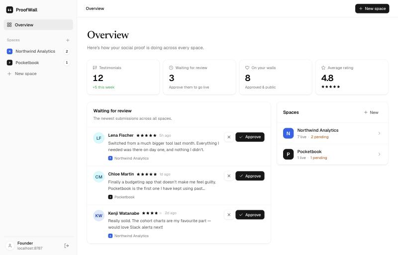
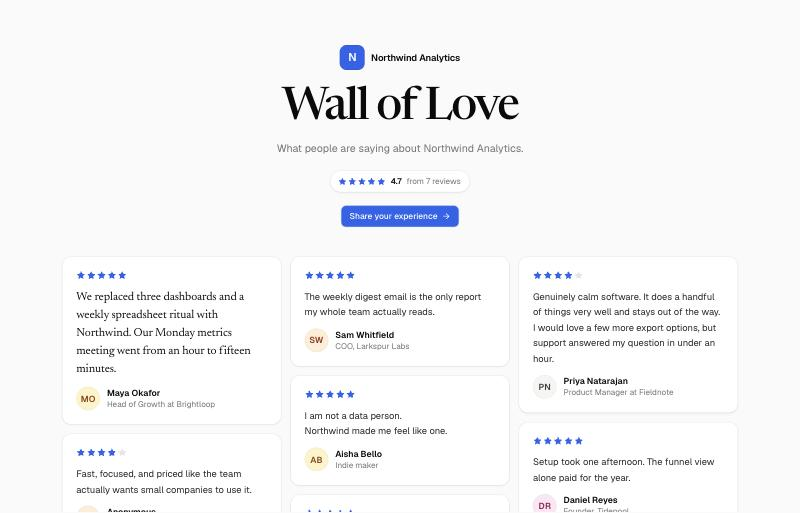
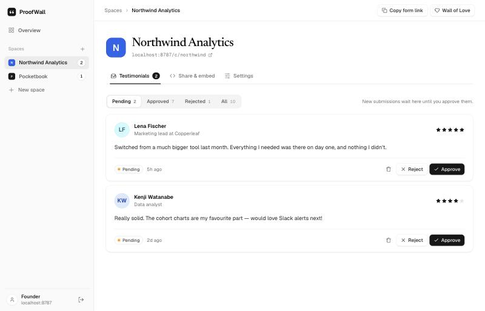
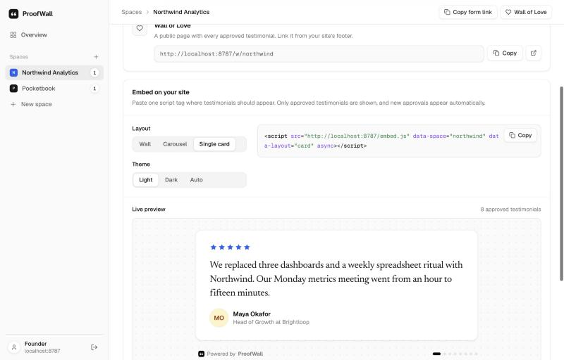

# ProofWall

**Collect testimonials. Show them anywhere.**
A small, self-hosted testimonial collector and Wall of Love that runs entirely on Cloudflare's free tier: Workers + Hono, D1 and R2. MIT licensed. One founder per deployment, and customers don't need accounts.

[](https://deploy.workers.cloudflare.com/?url=https://github.com/QuantumCoderSys/proofwall)
&nbsp;
[](#set-up-with-an-ai-agent)



---

## At a glance

### Data model (D1)

| Table          | What it holds                                                                                                                                                                            |
| -------------- | ---------------------------------------------------------------------------------------------------------------------------------------------------------------------------------------- |
| `spaces`       | One row per product or brand. Fields: `slug` (public URL), `name`, `logo_key` (R2), `accent_color`, form copy (`headline`, `prompt`, `thank_you`), and flags `collect_photo`, `is_accepting`, `show_branding`. |
| `testimonials` | `space_id`, `status` (`pending` → `approved` / `rejected`), `rating` (1–5, or empty for imported posts), `body`, optional `author_name` / `author_role`, `photo_key` (R2), `featured` (pinned first), and for imports `source` (`web` / `x` / `bluesky`), `source_url` and `external_id` (used to skip duplicates). Plus timestamps. |
| `import_sources` | Links that are re-checked daily for new testimonials, with the result of the last check.                                                                                              |
| `import_skips` | Imported testimonials you deleted, so a re-check never brings them back.                                                                                                                 |
| `rate_limits`  | Fixed-window counters for login attempts and public submissions. IPs are stored as SHA-256 hashes.                                                                                       |

Uploaded images live in **R2** under `photos/<random>.<ext>` and `logos/<random>.<ext>`. Keys are never reused, so the files are served as immutable. The schema is in [`migrations/`](migrations).

### Key routes

| Route                                  | Who      | Purpose                                                                   |
| -------------------------------------- | -------- | ------------------------------------------------------------------------- |
| `GET /c/:slug` · `POST /c/:slug`       | Public   | Collection form (rating, text, name, role, photo, consent)                |
| `GET /w/:slug`                         | Public   | Wall of Love page (approved only, can be iframed)                         |
| `GET /embed.js`                        | Public   | The embeddable widget (one script tag)                                    |
| `GET /api/v1/spaces/:slug`             | Public   | Approved testimonials as JSON. CORS `*`, cached 60s. Accepts `?limit=` and `?id=` |
| `GET /media/*`                         | Public   | Photos and logos from R2                                                  |
| `GET /login` · `POST /login` · `POST /logout` | Founder | Password sign-in (signed, HttpOnly session cookie)                 |
| `GET /app`                             | Founder  | Overview: totals, the review queue across spaces, and the list of spaces |
| `GET /app/spaces/:id`                  | Founder  | Moderate: approve, reject, pin, move back to pending, delete              |
| `GET /app/spaces/:id/import`           | Founder  | Import from a link (preview, then pick), the daily-checked links, and add by hand |
| `GET /app/spaces/:id/share`            | Founder  | Links, embed builder with a live preview, JSON endpoint                   |
| `GET /app/spaces/:id/settings`         | Founder  | Branding, form copy, toggles, delete space                                |
| Cron `23 7 * * *`                      | Worker   | Re-checks saved import links once a day                                   |

---

## Features

- **Dashboard**: create spaces (name, logo, accent colour), review a moderation inbox, approve or reject in one click, pin favourites, and copy embed code.
- **Collection form**: mobile-first, with a 1–5 star rating, text, optional name, role and photo. Photos are cropped and resized in the browser, which also strips EXIF/GPS data. Customers give explicit publishing consent, and a honeypot plus rate limiting keep spam out.
- **Import from the web, for free**: paste a review page, a post on X or Bluesky, or your own site's testimonials page. ProofWall pulls the testimonials out itself, with no scraping service or API keys. Saved links are re-checked daily, and new finds wait in your inbox. See [Import from the web](#import-from-the-web).
- **Wall of Love**: a public, SEO-friendly page for each space, with an average rating and a masonry layout.
- **Embeddable widget**: **wall**, **carousel** and **single card** layouts in light, dark or auto themes. It renders inside Shadow DOM, so your site's CSS can't break it. About 6 KB gzipped.
- **"Powered by ProofWall"**: a small, optional badge. Turn it off per space.
- **No paid services**: Workers, D1 and R2 free tiers are plenty for most founders.

| Collection form | Wall of Love |
| --- | --- |
|  |  |

| Moderation inbox | Embed: single card |
| --- | --- |
|  |  |

---

## Set up with an AI agent

Let your coding agent (Claude Code, Codex, Cursor and others) do the whole setup. Copy this prompt with the copy button on the box and paste it into your agent. It will ask you for a password and an optional domain before deploying anything.

```text
Set up ProofWall for me: a self-hosted testimonial collector that runs on my Cloudflare account.

Repository: https://github.com/QuantumCoderSys/proofwall

1. Clone the repository and read AGENTS.md. It has the exact setup steps; follow them.
2. Before deploying, ask me for:
   a. the dashboard password I want to use,
   b. a custom domain, if I want one (its parent domain must already be on my Cloudflare account),
   c. which Cloudflare account to use, if I have more than one.
3. Check that Node 20+ is installed and that Wrangler is logged in (run `npx wrangler login` if not; I'll approve it in my browser).
4. Deploy: create the D1 database and R2 bucket, set ADMIN_PASSWORD (mine) and a freshly generated SESSION_SECRET as Worker secrets, attach my custom domain if I gave one, and apply the D1 migrations.
5. Verify: the site loads over HTTPS, /login shows "Welcome back", and `wrangler secret list` shows both secrets.

Never print, log or commit secret values, and don't add my domain to wrangler.toml.
When you're done, tell me the URL and how to sign in.
```

---

## Quick start (local)

Requirements: Node 20+ and npm.

```bash
npm install
cp .env.example .dev.vars          # then edit ADMIN_PASSWORD and SESSION_SECRET
npm run db:migrate:local           # create tables in the local D1
npm run seed:local                 # optional: sample spaces & testimonials
npm run dev                        # http://localhost:8787
```

Sign in at `http://localhost:8787/login` with your `ADMIN_PASSWORD`. Local D1 and R2 data live in `.wrangler/state`.

---

## Deploy to Cloudflare

### Option A: Deploy button

[](https://deploy.workers.cloudflare.com/?url=https://github.com/QuantumCoderSys/proofwall)

Cloudflare copies this repo into your GitHub account, creates the D1 database and R2 bucket, asks for `ADMIN_PASSWORD` and `SESSION_SECRET` (read from `.env.example`), then builds and deploys with `npm run deploy`, which also applies the migrations. Every push to your copy redeploys automatically.

Running your own fork? Swap the `url=` parameter in the button link for your repo's URL.

### Option B: Wrangler CLI

```bash
npx wrangler login
npx wrangler secret put ADMIN_PASSWORD      # your dashboard password
npx wrangler secret put SESSION_SECRET      # paste the output of: openssl rand -hex 32
npm run deploy                              # deploys, then applies D1 migrations
```

`wrangler.toml` lists the D1 database (`proofwall`) and the R2 bucket (`proofwall-media`) **without IDs**. Wrangler ≥ 4.45 creates them for you on the first deploy and remembers them afterwards.

> **Prefer explicit resources?** Run `npx wrangler d1 create proofwall` and `npx wrangler r2 bucket create proofwall-media`, then paste the returned `database_id` into `wrangler.toml`.

If `wrangler secret put` complains that the Worker doesn't exist yet, run `npm run deploy` once first. The dashboard will show setup instructions until both secrets are set.

### Custom domain

In the Cloudflare dashboard, go to **Workers & Pages → proofwall → Settings → Domains & Routes → Add → Custom domain**, for example `love.yourproduct.com`. Embed snippets automatically use whatever domain the dashboard is opened on.

### Updating

Pull new changes and run `npm run deploy` again. New migrations are applied automatically.

---

## Import from the web

Already have testimonials elsewhere? Open a space, go to **Import**, and paste a link. The Worker fetches the page itself, so there's no scraping service, API key or bill. You see everything it found, untick what you don't want, and import it as pending or approved.

| Paste a link to… | What ProofWall reads |
| --- | --- |
| A review page | schema.org `Review` data in the page's JSON-LD. Tested with Product Hunt, Capterra and Sitejabber; many shops and review sites publish it. Ratings are converted to 5 stars. |
| A post on **X** or **Bluesky** | The post's public oEmbed (free, no API key): text, author, @handle and date. |
| Your own website | `<blockquote>` testimonials, with credit from `<cite>`, `<figcaption>` or a `<footer>` inside the quote, plus embedded X and Bluesky posts. |

**Checked daily.** When importing from a page, keep **"Check this page daily"** ticked. A free [Cron Trigger](https://developers.cloudflare.com/workers/configuration/cron-triggers/) re-checks saved links once a day, and anything new arrives as **pending**, so nothing goes public without your approval. Duplicates are skipped, and a testimonial you delete won't come back. Hit **Check now** to run a check immediately.

**Attribution.** Imported testimonials show a small "via X" or "via producthunt.com" link back to the original, on the wall and in embeds. Posts without stars simply show no stars, and they're left out of your average rating.

**Limits.** Some sites block automated access, including G2, Yelp, Trustpilot, LinkedIn and Google reviews, and pages that only load reviews with JavaScript can't be read either. For those, use **Add one by hand**: paste the words, credit the author and link to the original. It's always free and always works.

---

## How the embed works

Paste one tag where testimonials should appear:

```html
<script src="https://love.yourproduct.com/embed.js" data-space="your-slug" data-layout="carousel" async></script>
```

1. `embed.js` (a static asset, cached for 5 minutes) finds its own `<script>` tag and inserts a `<proofwall-embed>` element right before it.
2. It fetches `GET /api/v1/spaces/:slug`, which returns **approved testimonials only**, then renders them inside a **Shadow DOM**. Your page's CSS can't leak in, and the widget's CSS can't leak out.
3. All testimonial text is inserted as text nodes, never as HTML, so a malicious submission can't inject script into your site.
4. Approving or rejecting in the dashboard shows up on embeds within about a minute (the API cache TTL).

If the space has no approved testimonials yet, or the slug doesn't exist, the widget renders nothing, so your site never shows an empty box.

### Precise placement

Put any number of placeholders on the page, then load the script once:

```html
<div data-proofwall="your-slug" data-layout="wall"></div>
<div data-proofwall="your-slug" data-layout="card" data-theme="dark"></div>
<script src="https://love.yourproduct.com/embed.js" async></script>
```

### Options

| Attribute       | Values                          | Default | Notes                                                   |
| --------------- | ------------------------------- | ------- | ------------------------------------------------------- |
| `data-space`    | space slug                      | —       | Required in script-tag mode (`data-proofwall` on divs). |
| `data-layout`   | `wall` · `carousel` · `card`    | `wall`  | `card` shows one testimonial and rotates between the top ones. |
| `data-theme`    | `light` · `dark` · `auto`       | `light` | `auto` follows the visitor's OS setting.                |
| `data-limit`    | `1`–`100`                       | 50 / 20 / 10 | How many testimonials to fetch (wall / carousel / card). |
| `data-id`       | testimonial id                  | —       | Pin a `card` embed to one specific testimonial.        |
| `data-autoplay` | `false`                         | on      | Disable carousel / card auto-advance. Auto-advance is always off for reduced-motion users. |
| `data-font`     | `inherit`                       | Geist   | Use your site's font instead of loading Geist from Google Fonts. |

Pinned testimonials appear first and are set in a serif face, which gives a wall some visual rhythm.

### JavaScript API

```js
// After embed.js has loaded:
window.ProofWall.mount(document.querySelector('#reviews'), {
  space: 'your-slug',
  layout: 'carousel',
  theme: 'auto',
});
```

### No-script platforms (Notion, some site builders)

Embed the Wall of Love page as an iframe instead: `https://love.yourproduct.com/w/your-slug`. Collection and wall pages allow framing; the dashboard does not.

### JSON API

```bash
curl https://love.yourproduct.com/api/v1/spaces/your-slug?limit=10
```

```json
{
  "space": { "slug": "your-slug", "name": "Acme", "accentColor": "#2563eb", "logoUrl": null,
             "collectUrl": "…/c/your-slug", "wallUrl": "…/w/your-slug", "showBranding": true, "poweredByUrl": "…" },
  "testimonials": [
    { "id": "…", "rating": 5, "body": "…", "name": "Maya Okafor", "role": "Head of Growth",
      "photoUrl": "…/media/photos/….webp", "featured": true, "source": null, "sourceUrl": null,
      "createdAt": 1760000000000 },
    { "id": "…", "rating": null, "body": "…", "name": "Jordan Kim", "role": "@jordank", "photoUrl": null,
      "featured": false, "source": "x", "sourceUrl": "https://x.com/jordank/status/…", "createdAt": 1760000000000 }
  ],
  "stats": { "count": 42, "rated": 40, "average": 4.8 }
}
```

---

## Configuration

| Name             | Kind   | Required | Description                                                                  |
| ---------------- | ------ | -------- | ---------------------------------------------------------------------------- |
| `ADMIN_PASSWORD` | secret | yes      | Dashboard password. Changing it signs out all sessions.                      |
| `SESSION_SECRET` | secret | yes      | Signs the session cookie. Generate with `openssl rand -hex 32`.              |
| `POWERED_BY_URL` | var    | no       | Where the "Powered by ProofWall" badge links. Defaults to this deployment's homepage. |

Bindings (`wrangler.toml`): `DB` (D1), `MEDIA` (R2) and `ASSETS` (static files in `public/`). A daily cron trigger (`[triggers]`) runs the import checks; remove it if you don't use imports.

---

## Project structure

```
├── migrations/0001_init.sql     D1 schema
├── public/                      Static assets served by Workers Assets
│   ├── assets/app.css           Design system (light, card-based, Geist + Newsreader)
│   ├── _headers                 Cache/CORS headers for embed.js
│   └── favicon.svg
├── scripts/
│   ├── build-client.mjs         esbuild: widget → public/embed.js, dashboard JS → public/assets/app.js
│   └── seed.sql                 Sample data for local development
├── src/
│   ├── index.tsx                Hono app, middleware, error pages
│   ├── env.ts                   Binding types
│   ├── routes/                  auth · public (form + wall) · api · media · dashboard
│   ├── lib/                     db · auth · importer · auto-import · uploads · rate-limit · color · ids · http · format
│   ├── views/                   Server-rendered JSX (hono/jsx): shell, components, pages
│   ├── client/app.ts            Progressive enhancement (async moderation, copy, previews)
│   ├── widget/embed.ts          The embeddable widget
│   └── shared/                  Types and helpers shared by the Worker and the browser
├── wrangler.toml
└── .env.example
```

Everything is TypeScript. Pages are server-rendered with `hono/jsx` and work without JavaScript; `app.js` only adds polish, such as moderating without page reloads, copy buttons, image previews and the live embed preview.

```bash
npm run typecheck   # Worker + browser code
npm run build       # browser bundles (also runs automatically on dev/deploy)
```

---

## Security notes

- **Auth**: a single password, compared in constant time. Sessions are HMAC-signed, `HttpOnly`, `SameSite=Lax` cookies that last 30 days. Login is rate limited to 10 attempts per 15 minutes per IP.
- **CSRF**: every form POST is checked against the `Origin` / `Sec-Fetch-Site` headers (Hono `csrf()`).
- **Uploads**: files are identified by their magic bytes, not their extension. Photos are capped at 5 MB and logos at 2 MB. SVG is accepted for logos only and served with a `sandbox` CSP, so it can never run script.
- **Spam**: a honeypot field, plus a limit of 5 submissions per IP, per space, every 10 minutes.
- **Imports**: only you can trigger them, and only for http(s) links. They identify themselves with an honest `ProofWall/1.0` user agent and don't bypass sites that block bots. Imported text is stored and rendered as plain text, never HTML.
- **Headers**: a CSP on every HTML page, and `frame-ancestors 'none'` plus `X-Frame-Options: DENY` on the dashboard.
- **Privacy**: no third-party scripts or trackers. Visitor IPs are only ever stored hashed, in the rate-limit table.

---

## Troubleshooting

- **"Database not set up yet"**: run `npm run db:migrate:remote` (production) or `npm run db:migrate:local` (dev).
- **"Almost there" on the login page**: `ADMIN_PASSWORD` and/or `SESSION_SECRET` aren't set. In dev, check `.dev.vars`. In production, run `wrangler secret put`.
- **Embed shows nothing**: check that the slug matches the space's Public URL and that at least one testimonial is approved. The browser console prints a `[ProofWall]` warning if the request failed.

---

## License

[MIT](LICENSE). Use it, fork it, ship it.
